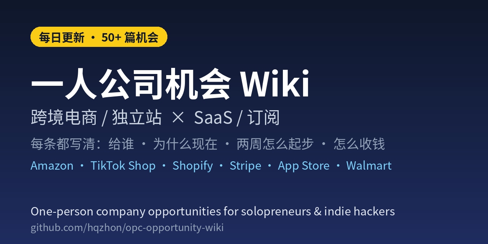

# 一人公司机会 Wiki

**平台每改一次规则，就有一批卖家需要有人帮他们查一遍——这就是一个人能接的单。**

跨境电商 / 独立站 × SaaS / 订阅的一人公司机会库：52 篇，**每日更新**，每篇都写清给谁、为什么现在、两周怎么起步、怎么收钱。

[先看这些](#先看这些) · [临期窗口](#临期窗口) · [全部条目](#全部条目) · [English](#english) · [参与贡献](CONTRIBUTING.md)

> 觉得有用就点右上角 ⭐ Star，新条目会出现在你的 GitHub 首页；想每天收到更新，点 **Watch → Custom → Releases** 或订阅 [commits RSS](https://github.com/hqzhon/opc-opportunity-wiki/commits/main.atom)。

## 适合谁

- **跨境 / 独立站卖家**：Amazon、TikTok Shop、Shopify、Etsy、Walmart 新规一出，先知道影响谁、要改什么
- **独立开发者 / 做 SaaS 的一人团队**：从平台变更里找「刚出现、还没人做」的工具和服务切口
- **接单的自由职业者 / 小代运营**：把每条「就绪体检」直接变成一份能报价的服务

## 每篇长什么样

以 [订阅失败支付挽回](wiki/entries/s2-dunning.md) 为例：

| 一句话 | 为什么现在 | 两周怎么起步 | 怎么收钱 |
| --- | --- | --- | --- |
| 给 Shopify App / 会员站 / 课程站做智能重试和催收序列，减少拒卡流失 | Stripe 称智能重试比固定日程多挽回约 14% 收入，但横向工具不懂垂直话术 | 接 `invoice.payment_failed` webhook → 按失败码分流 → 催收序列 + 自助换卡页 → 找 5–10 家试点 | 月费或挽回金额分成 |

每篇还有「目标客户」「难度」「注意的坑」和可点击的公开来源（官方 Changelog、帮助中心、政策页）。

## 先看这些

### 常青精选（新手从这里开始）

- [★ 订阅失败支付挽回（垂直化 dunning）](wiki/entries/s2-dunning.md) — Stripe / Shopify 订阅的拒卡挽回，按挽回金额收费，ROI 一眼可算
- [★ 垂直 AEO / AI 可见度追踪](wiki/entries/s1-vertical-aeo.md) — 帮垂直行业品牌看「AI 搜索里有没有提到我」，月度报告即可起步
- [★ 数字商品独立站（模板 / 微课 / AI Prompt Pack）](wiki/entries/e7-digital-dtc.md) — 模板、微课、Prompt Pack，零库存、可自动交付
- [★ AI + POD 轻资产定制（TikTok / 独立站）](wiki/entries/e1-ai-pod.md) — AI 出图 + 按需印刷，不压货测款
- [★ 退货原因 → 详情页修复闭环（服装独立站）](wiki/entries/s8-returns-listing.md) — 把退货原因变成详情页修改清单，服装独立站最痛
- [平台伴生小工具（Shopify / Notion 等）](wiki/entries/s3-platform-addon.md) — 给 Shopify / Notion 做伴生小工具，借平台流量冷启动

### 临期窗口

按截止日排序：越靠前越急，也越容易接到「帮我查一遍」的单。日期为平台公布的时间（2026 年，除非注明 2027）。

<!-- 新的临期条目按日期插入下表；截止已过的移出 -->
| 截止 | 发生什么 | 条目 |
| --- | --- | --- |
| **11-12 / 11-20** | Shopify 公开 App IP 白名单强制：先批量失败，再下架 | [s37](wiki/entries/s37-shopify-ip-allowlist-readiness.md) |
| **11-12** | TikTok Shop 运费与重量结算加严 | [s41](wiki/entries/s41-tiktok-shop-shipping-fee-weight-readiness.md) |
| **12-08** | TikTok Shop BFCM 保护期结束，低分店触发禁上新 | [s28](wiki/entries/s28-tiktok-shop-ahr-bfcm-readiness.md) |
| **12-18** | Amazon FBM 退货须预付面单，7 天不处理自动退款 | [s27](wiki/entries/s27-amazon-fbm-prepaid-return-label-readiness.md) |
| **2027-01-01** | Shopify 公开 App 须改用会过期的离线令牌 | [s33](wiki/entries/s33-shopify-expiring-offline-token-readiness.md) |
| **2027-01** | Walmart 单品卖家责任退货率高会被单独下架 | [s44](wiki/entries/s44-walmart-item-return-rate-readiness.md) |
| **2027-01-11** | Amazon 单 ASIN 捆绑须原厂包装 | [s34](wiki/entries/s34-amazon-bundle-manufacturer-packaging-readiness.md) |
| **2027-01-15 / 02-01** | Amazon FBA 配送费上调、仓储费改按库龄计 | [s45](wiki/entries/s45-amazon-fba-2027-fee-readiness.md) |
| **2027-01-20** | 美国邮政小包 Entry Type 13 电子申报 | [s35](wiki/entries/s35-us-postal-entry-type13-readiness.md) |
| **2027-01-22** | Stripe Radar 续费筛查免费试用结束、按次计费 | [s30](wiki/entries/s30-stripe-radar-renewal-cost-readiness.md) |
| **2027-01-31** | Google 商品图须 ≥500×500，AI 图须保留元数据 | [s43](wiki/entries/s43-google-merchant-image-500px-readiness.md) |

已生效、仍值得逐店检查：TikTok Shop 电子品类责任险 [s38](wiki/entries/s38-tiktok-shop-liability-insurance-readiness.md)、API 取消计入 SFCR [s39](wiki/entries/s39-tiktok-shop-api-sfcr-readiness.md)、Listing 新规 [s42](wiki/entries/s42-tiktok-shop-listing-policy-readiness.md)；Amazon 安全类目责任险 [s36](wiki/entries/s36-amazon-liability-insurance-readiness.md)；Apple 取消挽留消息 [s40](wiki/entries/s40-apple-retention-messages-readiness.md)、多席位 [s31](wiki/entries/s31-apple-multiseat-subscription-readiness.md)；Google Play 拒付 [s32](wiki/entries/s32-google-play-chargeback-review-readiness.md)；Etsy 商品图 [s29](wiki/entries/s29-etsy-listing-image-ai-readiness.md)；EU 低货值包裹 [s16](wiki/entries/s16-eu-product-identifiers.md) / [s17](wiki/entries/s17-eu-uhf-duty-recovery.md)。

## 全部条目

共 52 篇，按市场分组、组内按平台细分，一篇不漏。★ 为 [Catalog](wiki/Catalog.md) 中的优先验证方向。

<!-- 新条目：加到对应市场与平台小节末尾，并更新上方篇数与徽章 -->
### 跨境电商 / 独立站

#### 经营模式（常青）

- [★ AI + POD 轻资产定制（TikTok / 独立站）](wiki/entries/e1-ai-pod.md)
- [区域细分 + TikTok Shop 短视频自然流](wiki/entries/e2-tiktok-regional.md)
- [★ 高客单差异化独立站（先平台验证）](wiki/entries/e3-high-aov-dtc.md)
- [内容 SEO + Reddit / YouTube 有机引流独立站](wiki/entries/e4-organic-seo.md)
- [消耗品 / 宠物 / 美妆补货型订阅盒](wiki/entries/e5-subscription-box.md)
- [平台测款 → 品牌站沉淀的双通道模型](wiki/entries/e6-dual-channel.md)
- [★ 数字商品独立站（模板 / 微课 / AI Prompt Pack）](wiki/entries/e7-digital-dtc.md)

### SaaS / 订阅

#### 常青 SaaS 切口

- [★ 垂直 AEO / AI 可见度追踪](wiki/entries/s1-vertical-aeo.md)
- [★ 订阅失败支付挽回（垂直化 dunning）](wiki/entries/s2-dunning.md)
- [平台伴生小工具（Shopify / Notion 等）](wiki/entries/s3-platform-addon.md)
- [自由职业者轻量客户中枢](wiki/entries/s4-freelancer-hub.md)
- [长视频 → 短视频的垂直切片工具](wiki/entries/s5-video-clips.md)
- [购买意向线索预警（单一行业）](wiki/entries/s6-intent-leads.md)
- [★ 退货原因 → 详情页修复闭环（服装独立站）](wiki/entries/s8-returns-listing.md)
- [★ COM 客户自带物料入站追踪（定制家具 / 软装独立站）](wiki/entries/s10-com-inbound.md)

#### AI 购物代理 / Agentic Commerce

- [★ Shopify Agentic Catalog 就绪体检](wiki/entries/s7-agentic-catalog.md)
- [★ AI 购物代理政策 / 履约就绪体检（shipping · cancel · pickup）](wiki/entries/s9-agent-policy.md)
- [★ Google AI Mode / Gemini 直购结账就绪体检](wiki/entries/s11-google-direct-checkout.md)
- [★ UCP 零售门店发现就绪体检（Physical storefront × 库存 × 自提）](wiki/entries/s12-ucp-location.md)
- [★ Agentic Knowledge base 发布就绪体检（draft → publish × 冲突 × 迁移）](wiki/entries/s13-knowledge-base-publish.md)
- [★ 退货窗覆盖规则就绪体检（Override × 最短优先 × 政策页）](wiki/entries/s14-return-window-overrides.md)
- [★ Compare-at / list_price 代理可见就绪体检](wiki/entries/s15-compare-at-list-price.md)
- [★ 渠道商品数据映射就绪体检（Google / Meta / TikTok / Catalog）](wiki/entries/s20-channel-mapping-readiness.md)

#### Shopify 商家与 App 开发者

- [★ Managed Markets 保价一口价运费就绪体检](wiki/entries/s18-mm-flat-rate-shipping.md)
- [★ Shop Promise 就绪体检（US 履约徽章 × Catalog 排序信号）](wiki/entries/s21-shop-promise-readiness.md)
- [★ Shopify 公开 App 过期离线令牌迁移体检（01-01 下架 × 01-15 商家警告 × 04-01 返回 403）](wiki/entries/s33-shopify-expiring-offline-token-readiness.md)
- [★ Shopify 公开 App IP 白名单就绪体检（11-12 批量失败 × 11-20 下架 × ASN/静态 IP）](wiki/entries/s37-shopify-ip-allowlist-readiness.md)

#### Amazon 卖家

- [★ Amazon Seller Central 多渠道就绪体检（eBay / Shopify / TikTok / Walmart）](wiki/entries/s22-amazon-multichannel-readiness.md)
- [★ FBA 退货定制分级就绪体检（Customized grading × Grade and Resell）](wiki/entries/s23-fba-customized-grading-readiness.md)
- [★ FBA 部分退款按原因就绪体检（Partial Refunds × return reason）](wiki/entries/s24-fba-partial-refund-readiness.md)
- [★ Amazon 虚拟多件装就绪体检（Virtual Multipacks × 单件费率 × 不可恢复删除）](wiki/entries/s26-amazon-virtual-multipack-readiness.md)
- [★ Amazon FBM 预付退货面单就绪体检（12-18 起 × 7 天时钟 × 自动免退退款）](wiki/entries/s27-amazon-fbm-prepaid-return-label-readiness.md)
- [★ Amazon 捆绑商品原厂包装新规体检（01-11 起 × 授权信 × 不合规下架记违规）](wiki/entries/s34-amazon-bundle-manufacturer-packaging-readiness.md)
- [★ Amazon 安全类目百万责任险就绪体检（11-02 起 × 不论销量 × 中国卖家须走 AIA）](wiki/entries/s36-amazon-liability-insurance-readiness.md)
- [★ Amazon 2027 FBA 费用调整利润体检（01-15 配送费上调 × 02-01 库龄仓储费 × 低库存费改规则）](wiki/entries/s45-amazon-fba-2027-fee-readiness.md)

#### TikTok Shop 卖家

- [★ TikTok Shop 账户健康分 BFCM 就绪体检（11-04 新扣分 × 保护期只停处罚 × 12-08 回归）](wiki/entries/s28-tiktok-shop-ahr-bfcm-readiness.md)
- [★ TikTok Shop 美区电子品类责任险就绪体检（$10k 月 GMV × BD TikTok USA LLC × 持续维持）](wiki/entries/s38-tiktok-shop-liability-insurance-readiness.md)
- [★ TikTok Shop API 取消单计入 SFCR 就绪体检（11-02 起 × IM 取消卡 24h × ≤2.5%）](wiki/entries/s39-tiktok-shop-api-sfcr-readiness.md)
- [★ TikTok Shop 运费与重量结算加严就绪体检（11-12 起 × 虚高运费 × 改重降结算）](wiki/entries/s41-tiktok-shop-shipping-fee-weight-readiness.md)
- [★ TikTok Shop 商品 Listing 新规就绪体检（11-06 更新 × 禁外链 QR × 禁夸张宣称）](wiki/entries/s42-tiktok-shop-listing-policy-readiness.md)

#### Etsy / Walmart / Google Merchant

- [★ Etsy 商品图与 AI 新规就绪体检（一张未修图 × AI 教程禁售 × 不符被判退款）](wiki/entries/s29-etsy-listing-image-ai-readiness.md)
- [★ Google Merchant Center 商品图 500px 新规就绪体检（01-31 起 × AI 图须留元数据 × 促销标题禁写日期）](wiki/entries/s43-google-merchant-image-500px-readiness.md)
- [★ Walmart 单品退货率下架就绪体检（2027-01 起 × 账户达标也会单品下架 × 60 天卖家责任退货）](wiki/entries/s44-walmart-item-return-rate-readiness.md)

#### 跨境物流与税务（EU / UK / US）

- [★ EU 低货值包裹三件套商品标识符就绪体检](wiki/entries/s16-eu-product-identifiers.md)
- [★ EU €2 处理费 + €3 关税结账回收就绪体检](wiki/entries/s17-eu-uhf-duty-recovery.md)
- [★ UK VAT 履约仓路由就绪体检（>£135 GB）](wiki/entries/s19-uk-vat-fulfillment-routing.md)
- [★ 美国邮政小包 Entry Type 13 就绪体检（01-20 起 × 301 关税与 FDA/CPSC 类商品 × 缺数据被扣或退回）](wiki/entries/s35-us-postal-entry-type13-readiness.md)

#### 订阅收款（Stripe / App Store / Google Play）

- [★ Stripe 订阅暂停留存就绪体检（Portal pause × flexible billing × auto-pause）](wiki/entries/s25-stripe-pause-retention-readiness.md)
- [★ Stripe Radar 续费筛查计费就绪体检（10-21 续费计费 × 01-22 试用结束 × Lite 还是 Standard）](wiki/entries/s30-stripe-radar-renewal-cost-readiness.md)
- [★ Apple 订阅多席位就绪体检（10-22 默认开启 × 关错开关会停续费 × 冬季群组购买）](wiki/entries/s31-apple-multiseat-subscription-readiness.md)
- [★ Google Play 拒付成本就绪体检（8-03 后订单由开发者承担 × 24 小时 ReviewRefund × 只认第一次回应）](wiki/entries/s32-google-play-chargeback-review-readiness.md)
- [★ Apple 订阅取消挽留消息就绪体检（11-04 上线 × 取消流程文案/优惠 × 审核禁写价格）](wiki/entries/s40-apple-retention-messages-readiness.md)

### 其他导航

- [Wiki 首页](wiki/Home.md) — 用法与画像建议
- [完整索引表 Catalog](wiki/Catalog.md)
- [更新日志 digests](wiki/digests/)

## 怎么用

1. 从「常青精选」或「临期窗口」挑一条和你画像匹配的
2. 按「一句话 → 为什么现在 → 一人怎么起步」做 **2–4 周**最小验证
3. 没有付费信号就换切口，不要加预算硬扛

**收录标准**：一人可冷启动、有清晰客户与变现路径、有公开线索、能在 2–4 周内验证，至少满足两条。跳过空泛风口、纯广告和无法验证的「暴利」承诺。

## English

**One-Person Company Opportunity Wiki**: 52 Chinese-language playbooks for solopreneurs and indie hackers in cross-border e-commerce and SaaS/subscriptions, updated daily. Most entries turn a fresh platform policy change (Amazon, TikTok Shop, Shopify, Stripe, App Store, Google Play, Walmart, Etsy, Google Merchant Center) into a sellable "readiness audit" service: who is affected, why now, how one person can start in two weeks, how to charge, and the pitfalls, with links to official sources. Start with the [evergreen picks](#常青精选新手从这里开始) or the [deadline table](#临期窗口). ⭐ Star to follow along.

## 参与贡献

发现新的平台变更、过时信息或想补一手经验，欢迎 [提 Issue](https://github.com/hqzhon/opc-opportunity-wiki/issues/new/choose) 或 PR，规则见 [CONTRIBUTING.md](CONTRIBUTING.md)。如果某条帮你接到了单或避开了坑，也欢迎在 Issue 里分享。

## 免责与许可

本仓库内容仅供信息整理与学习交流，不构成投资、经营或法律建议。每条机会需自行验证可行性、合规与成本；外链原文版权归原作者。

内容采用 [CC BY 4.0](LICENSE) 许可：可自由转载和改编（含商用），请注明「一人公司机会 Wiki」并附本仓库链接。

---

**每日更新** · 如果这份清单对你有帮助，点个 ⭐ 让更多做一人公司的人看到

